# BB Video

An agent skill for making videos **in pure code** — no editing app, no stock footage.
Every frame is drawn with HTML / SVG / canvas as a pure function of time, rendered frame by frame in headless Chrome, with music and sound effects synthesized in code, and encoded with ffmpeg.

[Chinese version](README.zh-CN.md)

## The skill

| Skill | What it makes |
|---|---|
| <a href="skills/bb-video"><code>bb&#8288;-&#8288;video</code></a> | **Explainer videos** with voiceover, captions and background music, and **promo / launch videos** for websites, apps and software with beat-synced music and sound effects — 16:9 and 9:16, in 26 visual styles |

You make one choice: **the style**. Everything else (narration, storyboard, voice, music, sound, layout, checks) is the agent's job.

| Style | Looks like |
|---|---|
| `whiteboard` | an infinite hand-drawn board: handwriting, arrows, KaTeX formulas, cartoon characters that talk and point; ends on a numbered "knowledge map" |
| `riso` | risograph print: spot-colour overprint, halftone, slight misregistration, one magazine page per chapter |
| `ink` | ink-wash handscroll: brush strokes, seals, figures in Chinese painting style |
| `launch` | launch-event motion design: big type, product screens, light / dark / brand-colour stages |
| `origami` | folded paper: creases, shading, paper unfolding into the next scene |
| `pop` | pop art: Ben-Day dots, bold outlines, comic panels |
| `op` | op art: moving black-and-white fields (WebGL) |
| `cutout` | Matisse paper cut-outs |
| `ascii` | ASCII character art |
| `shadow` | shadow puppetry: carved, translucent leather puppets on a lamp-lit screen |
| `bauhaus` | constructivism / Bauhaus: geometry, primary colours, diagonal type |
| `pixel` | 8-bit game: sprites, game UI, chiptune |
| `chat` | the story told in a messaging app: bubbles, typing, voice notes, cards |
| `toy3d` | toy 3D: the product's real UI as physical slabs on a desk, a matte vinyl toy hopping across it (three.js) |
| `newsreel` | a 1930s cinema newsreel: archive photos with source tags, supers and rubber stamps on scratchy black-and-white film, intertitles, a brass march |
| `filmroom` | a coach's film session: real footage stops, a pen rings the player and draws her path, rewind and slow-motion replay with a tracked ring; a top-down tactics board and shot charts from game data |
| `mystery` | a deadpan mock-science TV show: a blue 4:3 old-TV picture, an outlined title with red key words, numbered "symptoms" in brush script acted out by rubber-hose cartoon stickers, a chat screen, a storm of words, then a test card; or a case-file look (fog, struck-out guesses, an evidence board, a sourced answer) |
| `isometric` | an isometric miniature world: tiles on plinths, low-poly buildings, belts, vans and little people that move on their own; one thing followed through a whole system, its route painted on the ground, a clock on each stage, the part being talked about lifts while the rest fades (three.js) |
| `trailer` | a Hollywood movie trailer in a 2.39:1 letterbox: code-painted cinematic shots (space, planets, corridors, rim-lit silhouettes) under a teal-orange grade and grain, black one-phrase cards in metallic type, a lone piano ping and a ticking clock, then BRAAMs and taiko as the cuts speed up, a beat of silence, the title slam, the release date and the billing block |
| `dossier` | finance / news commentary made of paper: newspaper clippings with a highlighted headline and halftone photos, real source documents under an invented masthead with the camera pushing into the quoted line and a translation bar or tag landing on it, sheets flying in, ink-brush wipes, thumbnail title cards, data callouts, a chapter bar and outlined captions |
| `manga` | a black-and-white manga page that moves: screentone, panels with gutters, slanted and bleeding frames, speed and focus lines, drawn Japanese sound effects and balloons; the camera reads panel by panel, punches in and shakes on the hits, pages turn or get slashed open, a full-page splash for the climax; original code-drawn characters |
| `map` | an animated map from real geodata: paper land, engraved water lines along the coast, parks, street texture, cartographic labels; routes draw on stroke by stroke, a tram or train travels a line and stops on the word, stations pop in, areas spread like ink, callout cards pinned to places, a year counter and a locator globe; the camera turns the globe, dives to the street, flies between places and tilts to follow a train |
| `swiss` | Swiss poster kinetic typography: giant grotesk type cropped by the frame edge on a grid, black plus one accent taken from the brand; letters rise one by one, digits roll into place, the poster pulls out into a wall of its colour variants, a word repeats into a full-screen pattern; the information is typography too: numbered lists, check-chip grids, giant numerals, bar charts, old / new comparisons, real screenshots annotated like poster elements |
| `lumen` | a dark motivational animated short: a code-drawn room nearly all black, lit by one motivated light — a phone screen on a face, a red alarm clock, a desk lamp, moonlight through blinds, dawn at a window — with rim light, a giant shadow on the wall, haze and grain; one original protagonist (a soft square head, a cowlick that shows the mood) acts everything with eyes and brows; slow push-ins that hold on the face, a low second-person voice, white thumbnail-style title cards; facts told in light: a clock racing, gauges, the night as a line, an x-ray of the head |
| `blueprint` | a blueprint engineering drawing: cyanotype paper with a grid, white line work drafted in construction lines first, dimensions, leaders with numbered balloons, hatched sections, a parts list, a title block and one red pencil; mechanisms really work — gear trains mesh and turn at the right ratios, an escapement locks and releases, springs wind down, cams and levers move — in slow motion or time-lapse shown on the sheet; each subject arrives on a new sheet, and the camera pushes into a detail while the rest of the drawing falls back |
| `collage` | a paper-collage news explainer: one take across a table covered in torn paper — halftone photos with credits, faded poster layers, red rubber stamps, a typewriter quote with a highlighter sweep, tape and push pins; the camera floats, pushes in and travels with depth of field; numbers and history are told with paper props — a paper-doll grid that turns red, a red thread pinned along a timeline, cut-paper bars on notebook paper, a line chart on graph paper with pins riding the lines, a big character printed on a certificate; a fixed frame with channel, date and a source line |

What it covers:

- **Explainers**: phenomena ("why is the sky blue"), problem walkthroughs (including screenshots of problems), vocabulary, concepts, historical stories, how-tos, trivia, news and data.
- **Promos**: give it a URL; it researches the site (text, numbers, colours), captures screenshots, and builds a beat-driven promo with the product's real UI and brand colours.
- **Everything built in**: edge-tts voiceover with word-level timing, captions, music and sound effects synthesized in code, a cover frame, portrait (9:16) versions.
- **Self-checking**: before rendering, a lint check reports overlaps, text that leaves before it can be read, things off-frame, facts on screen that aren't in the brief, thin information, motion problems; after rendering, a frame check reports jumps, one-frame flashes and dead air (seconds of music with nothing new on screen).
- **Speaks your language**: the video follows the language of your request. Chinese and English are fully tuned; other languages work with any [edge-tts voice](https://github.com/rany2/edge-tts).

<!-- gallery:start -->
## Examples

One sample per style, all made with this skill (GIFs are 7 s cuts; the full mp4s with sound are on the [samples release](https://github.com/BubbleBrainBB/BB-Video/releases/tag/samples)). Narration is in Chinese; the four website promos and the swiss sample are music-only.

<table>
<tr>
<td width="33%" valign="top">
<a href="https://github.com/BubbleBrainBB/BB-Video/releases/download/samples/whiteboard.mp4">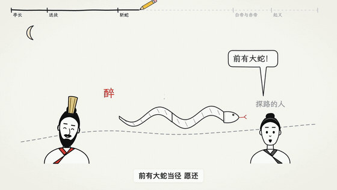</a><br>
<b><code>whiteboard</code></b> · Liu Bang slays the white snake (a Han-dynasty legend)<br>
<a href="https://github.com/BubbleBrainBB/BB-Video/releases/download/samples/whiteboard.mp4">Full video</a>
</td>
<td width="33%" valign="top">
<a href="https://github.com/BubbleBrainBB/BB-Video/releases/download/samples/riso.mp4">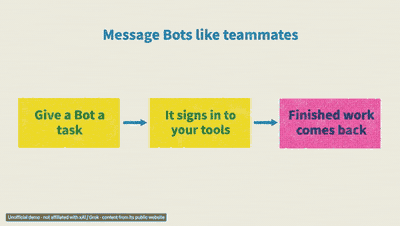</a><br>
<b><code>riso</code></b> · Grok Bot, a kinetic promo<br>
<sub>Footage from its public website</sub><br>
<a href="https://github.com/BubbleBrainBB/BB-Video/releases/download/samples/riso.mp4">Full video</a>
</td>
<td width="33%" valign="top">
<a href="https://github.com/BubbleBrainBB/BB-Video/releases/download/samples/ink.mp4">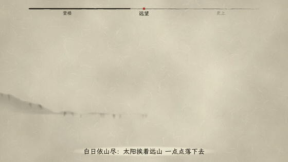</a><br>
<b><code>ink</code></b> · The Tang poem "On Stork Tower"<br>
<a href="https://github.com/BubbleBrainBB/BB-Video/releases/download/samples/ink.mp4">Full video</a>
</td>
</tr>
<tr>
<td width="33%" valign="top">
<a href="https://github.com/BubbleBrainBB/BB-Video/releases/download/samples/launch.mp4">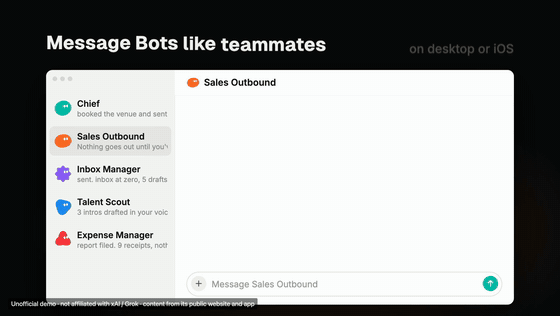</a><br>
<b><code>launch</code></b> · Grok Bot, a launch film<br>
<sub>Footage from its public website and app</sub><br>
<a href="https://github.com/BubbleBrainBB/BB-Video/releases/download/samples/launch.mp4">Full video</a>
</td>
<td width="33%" valign="top">
<a href="https://github.com/BubbleBrainBB/BB-Video/releases/download/samples/origami.mp4">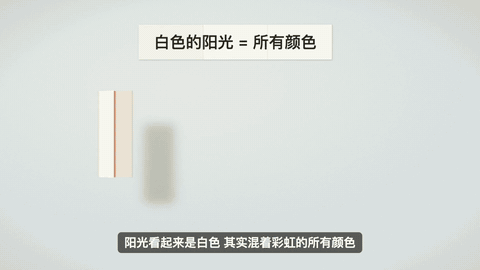</a><br>
<b><code>origami</code></b> · Why is the sky blue?<br>
<a href="https://github.com/BubbleBrainBB/BB-Video/releases/download/samples/origami.mp4">Full video</a>
</td>
<td width="33%" valign="top">
<a href="https://github.com/BubbleBrainBB/BB-Video/releases/download/samples/pop.mp4"></a><br>
<b><code>pop</code></b> · Why is the sky blue?<br>
<a href="https://github.com/BubbleBrainBB/BB-Video/releases/download/samples/pop.mp4">Full video</a>
</td>
</tr>
<tr>
<td width="33%" valign="top">
<a href="https://github.com/BubbleBrainBB/BB-Video/releases/download/samples/op.mp4">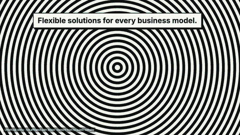</a><br>
<b><code>op</code></b> · Stripe, from its homepage<br>
<sub>Footage from its public website</sub><br>
<a href="https://github.com/BubbleBrainBB/BB-Video/releases/download/samples/op.mp4">Full video</a>
</td>
<td width="33%" valign="top">
<a href="https://github.com/BubbleBrainBB/BB-Video/releases/download/samples/cutout.mp4">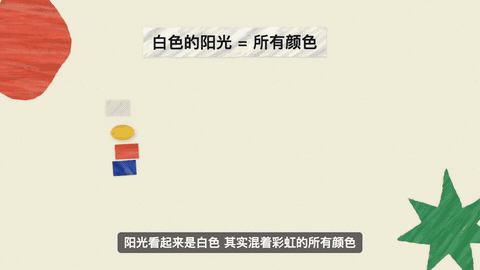</a><br>
<b><code>cutout</code></b> · Why is the sky blue?<br>
<a href="https://github.com/BubbleBrainBB/BB-Video/releases/download/samples/cutout.mp4">Full video</a>
</td>
<td width="33%" valign="top">
<a href="https://github.com/BubbleBrainBB/BB-Video/releases/download/samples/ascii.mp4">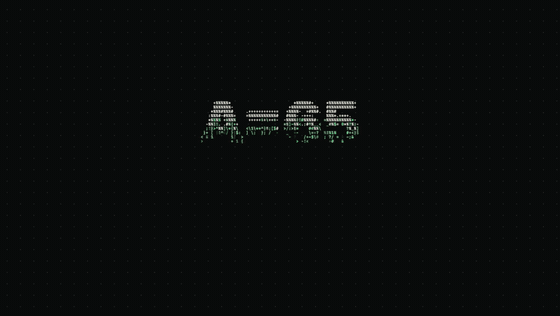</a><br>
<b><code>ascii</code></b> · What is ASCII?<br>
<a href="https://github.com/BubbleBrainBB/BB-Video/releases/download/samples/ascii.mp4">Full video</a>
</td>
</tr>
<tr>
<td width="33%" valign="top">
<a href="https://github.com/BubbleBrainBB/BB-Video/releases/download/samples/shadow.mp4">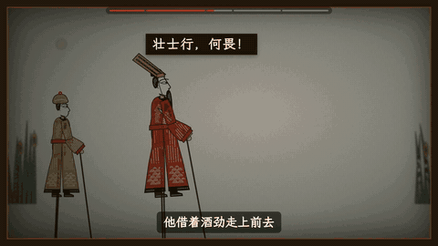</a><br>
<b><code>shadow</code></b> · Liu Bang slays the white snake, with character voices<br>
<a href="https://github.com/BubbleBrainBB/BB-Video/releases/download/samples/shadow.mp4">Full video</a>
</td>
<td width="33%" valign="top">
<a href="https://github.com/BubbleBrainBB/BB-Video/releases/download/samples/bauhaus.mp4">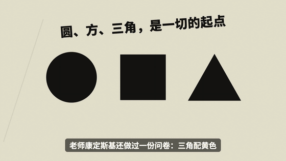</a><br>
<b><code>bauhaus</code></b> · The Bauhaus: a school that lasted fourteen years<br>
<a href="https://github.com/BubbleBrainBB/BB-Video/releases/download/samples/bauhaus.mp4">Full video</a>
</td>
<td width="33%" valign="top">
<a href="https://github.com/BubbleBrainBB/BB-Video/releases/download/samples/pixel.mp4">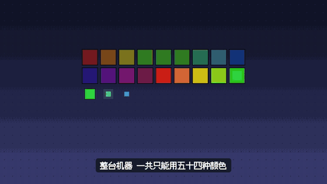</a><br>
<b><code>pixel</code></b> · Why old Famicom games had so few colours<br>
<a href="https://github.com/BubbleBrainBB/BB-Video/releases/download/samples/pixel.mp4">Full video</a>
</td>
</tr>
<tr>
<td width="33%" valign="top">
<a href="https://github.com/BubbleBrainBB/BB-Video/releases/download/samples/chat.mp4"></a><br>
<b><code>chat</code></b> · Lychees for Lady Yang, told as a group chat<br>
<a href="https://github.com/BubbleBrainBB/BB-Video/releases/download/samples/chat.mp4">Full video</a>
</td>
<td width="33%" valign="top">
<a href="https://github.com/BubbleBrainBB/BB-Video/releases/download/samples/toy3d.mp4"></a><br>
<b><code>toy3d</code></b> · Linear website promo<br>
<sub>Footage from its public website</sub><br>
<a href="https://github.com/BubbleBrainBB/BB-Video/releases/download/samples/toy3d.mp4">Full video</a>
</td>
<td width="33%" valign="top">
<a href="https://github.com/BubbleBrainBB/BB-Video/releases/download/samples/newsreel.mp4"></a><br>
<b><code>newsreel</code></b> · The 2026 Tesla Roadster reveal, as a 1930s newsreel<br>
<sub>Photos from Wikimedia Commons (CC0 / public domain / CC BY 2.0 Steve Jurvetson)</sub><br>
<a href="https://github.com/BubbleBrainBB/BB-Video/releases/download/samples/newsreel.mp4">Full video</a>
</td>
</tr>
<tr>
<td width="33%" valign="top">
<a href="https://github.com/BubbleBrainBB/BB-Video/releases/download/samples/filmroom.mp4">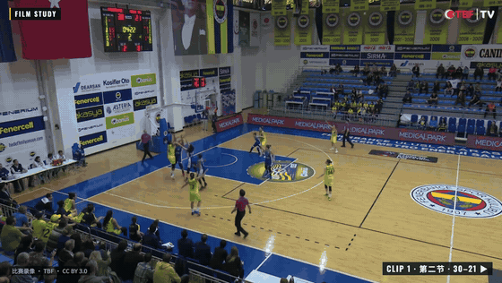</a><br>
<b><code>filmroom</code></b> · How one basket happened: Fenerbahçe vs Samsun Canik, 2018<br>
<sub>Game footage: TBF, CC BY 3.0, via Wikimedia Commons</sub><br>
<a href="https://github.com/BubbleBrainBB/BB-Video/releases/download/samples/filmroom.mp4">Full video</a>
</td>
<td width="33%" valign="top">
<a href="https://github.com/BubbleBrainBB/BB-Video/releases/download/samples/mystery.mp4">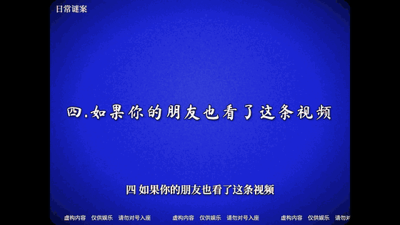</a><br>
<b><code>mystery</code></b> · Why your friend should call you dad (a deadpan mock-science proof)<br>
<sub>Fiction, for fun · cartoons drawn in code</sub><br>
<a href="https://github.com/BubbleBrainBB/BB-Video/releases/download/samples/mystery.mp4">Full video</a>
</td>
<td width="33%" valign="top">
<a href="https://github.com/BubbleBrainBB/BB-Video/releases/download/samples/isometric.mp4">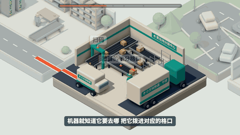</a><br>
<b><code>isometric</code></b> · How a parcel gets to you: one parcel followed from the warehouse to your door<br>
<sub>Figures: China's State Post Bureau, 2025 · the little world and its courier brand are drawn in code</sub><br>
<a href="https://github.com/BubbleBrainBB/BB-Video/releases/download/samples/isometric.mp4">Full video</a>
</td>
</tr>
<tr>
<td width="33%" valign="top">
<a href="https://github.com/BubbleBrainBB/BB-Video/releases/download/samples/trailer.mp4">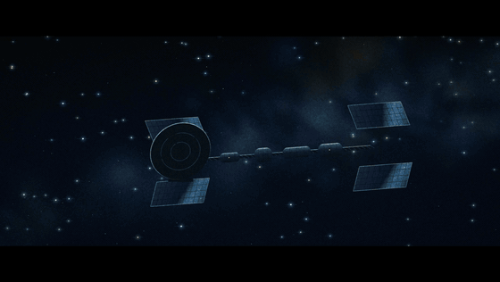</a><br>
<b><code>trailer</code></b> · Deep Space Echo, the trailer for an original, fictional sci-fi film<br>
<sub>A fictional film · every shot, sound and name made in code</sub><br>
<a href="https://github.com/BubbleBrainBB/BB-Video/releases/download/samples/trailer.mp4">Full video</a>
</td>
<td width="33%" valign="top">
<a href="https://github.com/BubbleBrainBB/BB-Video/releases/download/samples/dossier.mp4">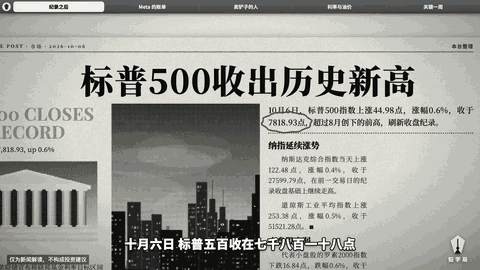</a><br>
<b><code>dossier</code></b> · AI's bill: US tech stocks in October 2026, from a record high to the week of the Fed<br>
<sub>News commentary, not investment advice · documents quoted from SEC, TSMC, Federal Reserve and company releases · pictures drawn in code</sub><br>
<a href="https://github.com/BubbleBrainBB/BB-Video/releases/download/samples/dossier.mp4">Full video</a>
</td>
<td width="33%" valign="top">
<a href="https://github.com/BubbleBrainBB/BB-Video/releases/download/samples/manga.mp4">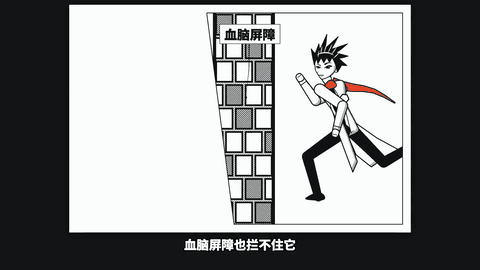</a><br>
<b><code>manga</code></b> · Caffeine's 45 minutes: how a cup of coffee keeps you awake, told as a shōnen battle<br>
<sub>General health information, not medical advice · original characters drawn in code · sources: IOM, EFSA, FDA, Reichert et al. 2022</sub><br>
<a href="https://github.com/BubbleBrainBB/BB-Video/releases/download/samples/manga.mp4">Full video</a>
</td>
</tr>
<tr>
<td width="33%" valign="top">
<a href="https://github.com/BubbleBrainBB/BB-Video/releases/download/samples/map.mp4">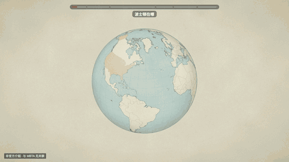</a><br>
<b><code>map</code></b> · The Boston subway: from the 1897 tunnel under Boston Common to today's four-colour network<br>
<sub>Map drawn from MassDOT / MBTA data, U.S. Census TIGER/Line and Natural Earth</sub><br>
<a href="https://github.com/BubbleBrainBB/BB-Video/releases/download/samples/map.mp4">Full video</a>
</td>
<td width="33%" valign="top">
<a href="https://github.com/BubbleBrainBB/BB-Video/releases/download/samples/swiss.mp4"></a><br>
<b><code>swiss</code></b> · Artificial Analysis Intelligence Index v5: the AI benchmark launched on October 27, 2026 — nine evaluations, the leaderboard, the open-weights gap, cost per task<br>
<sub>Figures and charts from artificialanalysis.ai</sub><br>
<a href="https://github.com/BubbleBrainBB/BB-Video/releases/download/samples/swiss.mp4">Full video</a>
</td>
<td width="33%" valign="top">
<a href="https://github.com/BubbleBrainBB/BB-Video/releases/download/samples/lumen.mp4">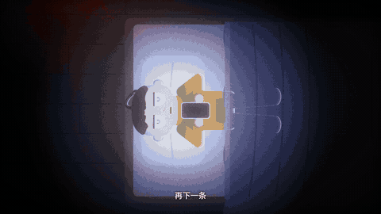</a><br>
<b><code>lumen</code></b> · Five more minutes: revenge bedtime procrastination — the night that won't end, what it costs the next day, and one small decision<br>
<sub>General health information, not medical advice · original character and sets drawn in code · sources: Kroese et al. 2014, CDC / AASM, Williamson &amp; Feyer 2000, Van Dongen et al. 2003, Chang et al. 2015</sub><br>
<a href="https://github.com/BubbleBrainBB/BB-Video/releases/download/samples/lumen.mp4">Full video</a>
</td>
</tr>
<tr>
<td width="33%" valign="top">
<a href="https://github.com/BubbleBrainBB/BB-Video/releases/download/samples/blueprint.mp4">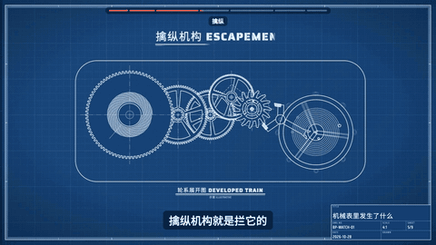</a><br>
<b><code>blueprint</code></b> · What happens inside a mechanical watch: mainspring, going train, escapement, balance, motion work — drawn and running at the right ratios<br>
<sub>A generic, illustrative movement · facts from Wikipedia</sub><br>
<a href="https://github.com/BubbleBrainBB/BB-Video/releases/download/samples/blueprint.mp4">Full video</a>
</td>
<td width="33%" valign="top">
<a href="https://github.com/BubbleBrainBB/BB-Video/releases/download/samples/collage.mp4">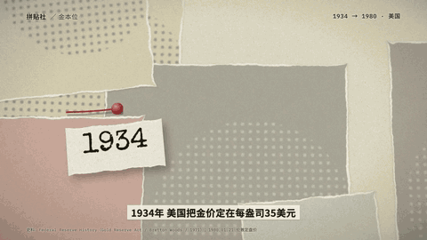</a><br>
<b><code>collage</code></b> · Gold, from $35 to $5,318: the 1934 peg, Bretton Woods, Nixon closing the gold window, central banks buying, and 2026's record and sell-off<br>
<sub>Photos via Wikimedia Commons: NARA, Oliver F. Atkins (public domain), Stevebidmead (CC0) · prices: COMEX, World Gold Council, Reuters</sub><br>
<a href="https://github.com/BubbleBrainBB/BB-Video/releases/download/samples/collage.mp4">Full video</a>
</td>
</tr>
</table>
<!-- gallery:end -->

## Install

With the [`skills`](https://github.com/vercel-labs/skills) CLI (Claude Code, Codex, Cursor, OpenCode and other agents):

```bash
npx skills add BubbleBrainBB/BB-Video                                          # pick interactively
npx skills add BubbleBrainBB/BB-Video --skill bb-video -a claude-code -g   # globally for Claude Code
```

Or copy the folder yourself:

```bash
git clone https://github.com/BubbleBrainBB/BB-Video.git
cp -r BB-Video/skills/bb-video ~/.claude/skills/
```


### Requirements

No npm dependencies. It needs:

- **Node.js 18+**
- **Google Chrome** or Chromium (set `CHROME_PATH` if it is not in the default location)
- **ffmpeg** on your `PATH`
- **Python 3** and **[edge-tts](https://github.com/rany2/edge-tts)** for the voiceover (`pip install edge-tts`)
- An internet connection for the voiceover, web fonts and the few libraries some styles load from jsDelivr (three.js for `toy3d`; GSAP / Matter.js only if a page asks for them)
- Optional: [Blender](https://www.blender.org) 3.6+ for `toy3d` mascots (otherwise three.js builds them)

## Usage

Just ask your agent, for example:

- "Make a whiteboard explainer: why is the sky blue?"
- "Turn this geometry problem into a walkthrough video" (attach a screenshot)
- "Make a launch video for https://example.com, 16:9 and 9:16"
- "Tell the story of Liu Bang slaying the white snake as a shadow-puppet video"
- "Tell a historical anecdote as a chat-log video"

The agent shows you the facts, narration and storyboard first, then voices, draws and renders. Output goes to `videos/<name>/out/` (mp4, cover, and for whiteboard / riso a board overview image). Open `videos/<name>/index.html` in a browser to preview and scrub.

## How it works

```
script.json (narration) ──► tts.py ──► audio + word-level timeline
index.html  (drawing code, renderFrame(t)) ──► render.mjs ──► Chrome, frame by frame ──► ffmpeg ──► mp4
                                                     ├─► lint check, captions, music + sound effects
                                                     └─► frame check (jumps, flashes, dead air)
```

Each frame is a pure function of time, so renders are deterministic and parallel, and the agent can look at any moment as a still before rendering the whole video.

## Privacy & security

- **Narration text is sent to Microsoft's online speech service** (that is how edge-tts works). Don't put confidential material in the narration.
- **Promo research opens the website you give it** in headless Chrome and takes screenshots (no logins, no downloads of site files).
- **Archive photo search** (`footage.mjs`, used when a film needs real photos you didn't supply) sends the search words to the Wikimedia Commons API, and downloads only the files you approve, with their licence and credit.
- Web fonts and libraries come from jsDelivr / unpkg at pinned versions. Nothing else goes over the network: no telemetry, no API keys, no accounts.
- `render.mjs` opens a project's `index.html` in headless Chrome with local file access, which means running that project's code. Render only projects you or your agent made.

## License

[MIT](LICENSE). Bundled third-party code: [KaTeX](https://katex.org) (MIT, see `skills/bb-video/explainer/runtime/katex/LICENSE`). Loaded from CDNs under their own licenses: three.js (MIT), GSAP (Standard "no charge" license), Matter.js (MIT); fonts LXGW WenKai, Excalifont, Noto Sans / Serif SC, Inter, Oswald and others (SIL OFL 1.1).
